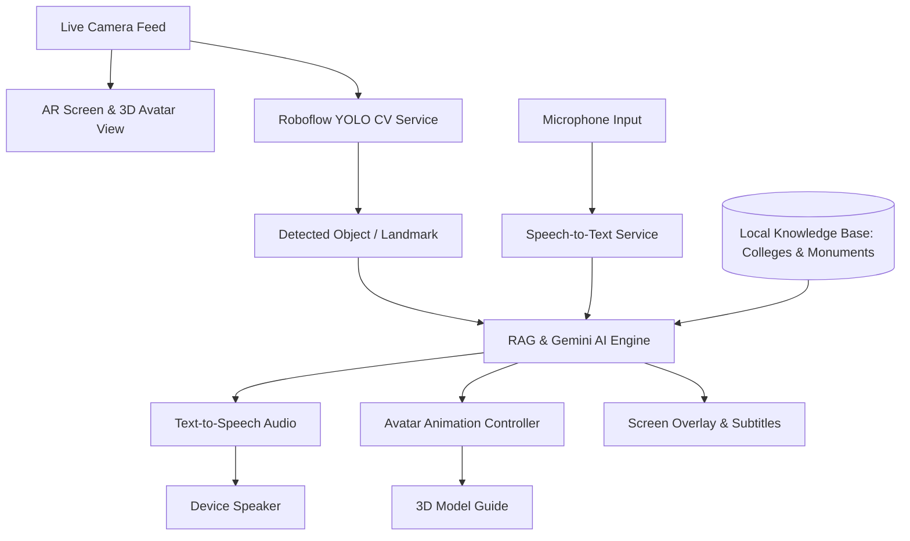

# 🏛️ AR Vista – AI-Powered Augmented Reality Campus & Tourism Guide

[](https://flutter.dev)
[](https://dart.dev)
[](https://ai.google.dev/)
[](https://roboflow.com)
[](https://developer.android.com)

An intelligent, multimodal AR tour guide mobile application that turns your smartphone into an interactive personal guide for college campuses and historical landmarks.

Developed by **Shubham Gala**

---

## 🌟 Key Features

### 🥽 1. Real-Time Augmented Reality & 3D Avatar
- **Live Camera Overlay**: Renders interactive elements directly on top of your live camera feed.
- **Interactive 3D Virtual Guide**: Animated 3D model avatar powered by WebGL/`model_viewer_plus`.
- **Dynamic Avatar Animations**: Smoothly alternates between `waving`, `talking`, and `pointing` gestures based on conversation and detections.

### 👁️ 2. Real-Time Computer Vision (YOLO)
- Instant recognition of landmarks, campus buildings, classrooms, labs, and monuments using custom-trained YOLO object detection via Roboflow.
- Auto-detects campus hotspots (*Achievement Wall, CSEDS Gate, Computer Labs, Classrooms, Benches*) and historical monuments (*Taj Mahal, Shrimant Dagdusheth Ganpati*).

### 🧠 3. Conversational AI & RAG Engine (Google Gemini)
- **Retrieval-Augmented Generation (RAG)**: Integrates contextual JSON knowledge bases with Google Gemini LLM for accurate, hallucination-free answers.
- **Context & Conversation Memory**: Retains the last 20 conversation turns and detected landmarks for multi-turn natural dialogue.
- **Emotion Modes**: Adapts guide personality based on user preference:
  - 🤩 **Excited**: Energetic and enthusiastic.
  - 🧘 **Calm**: Peaceful and meditative.
  - 📖 **Storytelling**: Narrative, historical, and engaging.

### 🎙️ 4. Multilingual Voice Interaction
- **Speech-to-Text (STT)**: Hands-free voice commands via microphone.
- **Text-to-Speech (TTS)**: Realistic synthesized voice narration.
- **Multi-Language Support**: Seamlessly communicates in English, Hindi, and Marathi.

### 🗺️ 5. Interactive Maps & Itinerary Planner
- Interactive OpenStreetMap integration with landmark markers.
- Smart tour itinerary generator customized to user interests and schedules.
- Nearby places and amenities discovery.

---

## 🏗️ System Architecture



---

## 📱 Tech Stack & Libraries

| Category | Technology |
|---|---|
| **Framework** | [Flutter](https://flutter.dev) (Dart) |
| **Generative AI** | [Google Gemini Flash](https://ai.google.dev/) (RAG Pipeline) |
| **Computer Vision** | YOLO via [Roboflow](https://roboflow.com) API |
| **3D Rendering** | `model_viewer_plus` (WebGL, 3D glTF/GLB models) |
| **Voice & Audio** | `speech_to_text`, `flutter_tts`, `audioplayers` |
| **Mapping & Location** | `flutter_map`, `latlong2`, `sensors_plus` |
| **State & Storage** | `shared_preferences`, `path_provider` |

---

## 🚀 Getting Started

### Prerequisites
- [Flutter SDK](https://docs.flutter.dev/get-started/install) (v3.7 or higher)
- [Android Studio](https://developer.android.com/studio) with Android SDK & Platform Tools
- Physical Android phone with USB Debugging enabled (recommended for camera and sensors)

### Quick Installation (Pre-built APK)
If you want to test the app on an Android device without building from scratch:
1. Locate `build/app/outputs/flutter-apk/app-release.apk`.
2. Transfer and open the APK on your device and follow the installation prompt.
3. Grant Camera, Microphone, and Location permissions.

### Build & Run from Source

1. **Clone the repository:**
   ```bash
   git clone https://github.com/shubhamgala/ar_vista.git
   cd ar_vista
   ```

2. **Install dependencies:**
   ```bash
   flutter pub get
   ```

3. **Connect your Android phone** via USB and verify:
   ```bash
   flutter devices
   ```

4. **Run the app:**
   ```bash
   flutter run
   ```

5. **Build Release APK:**
   ```bash
   flutter build apk --release --no-shrink
   ```

---

## 📂 Project Directory Structure

```text
├── android/               # Android native configuration & manifests
├── assets/                # 3D models (.glb), images, audio & knowledge JSON
│   ├── all_anim.glb       # 3D avatar with animated gestures
│   ├── knowledge/         # Curated domain knowledge for RAG
│   └── namaste.mp3        # Welcome audio cue
├── ios/                   # iOS native configuration
├── lib/
│   ├── main.dart          # App initialization & routing
│   ├── models/            # Data models (Itinerary, Places)
│   ├── screens/           # UI Screens (AR, Maps, Itinerary, Nearby)
│   ├── services/          # Gemini RAG, YOLO, Voice, Sentiment, Language
│   └── widgets/           # Custom reusable UI components
├── pubspec.yaml           # Flutter dependencies & asset registration
└── README.md              # Project documentation
```

---

## 👤 Author

**Shubham Gala**
- GitHub: [@shubhamgala](https://github.com/shubhamgala)

---

## 📄 License
This project is licensed under the MIT License.
